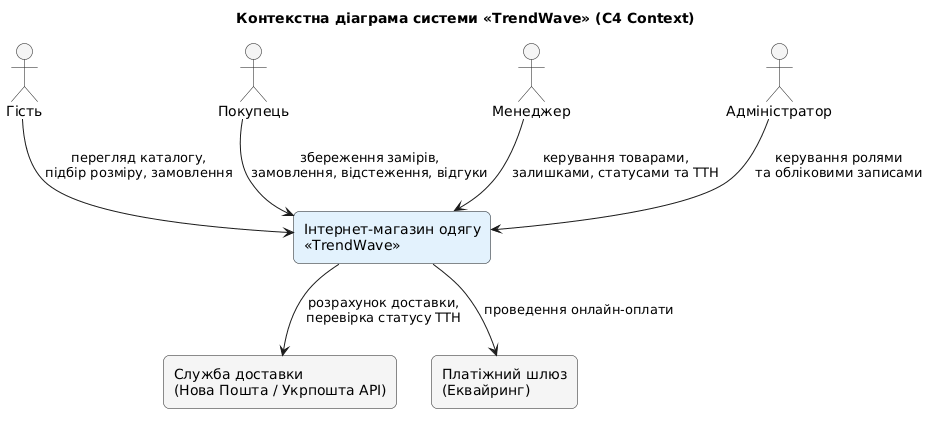
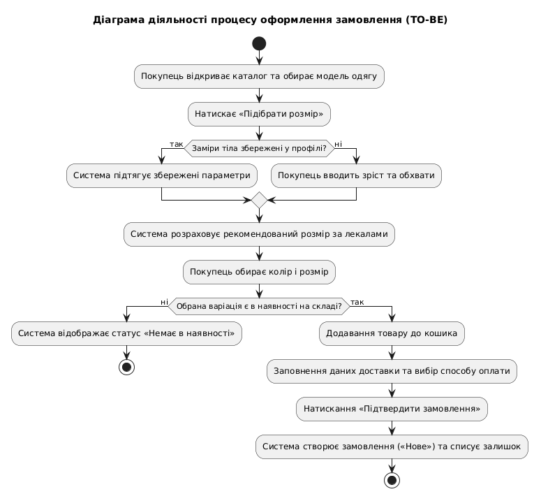

# Вступ до моделювання програмної системи «TrendWave»

## 1. Карта моделей проєкту

| Запитання, на яке відповідає модель | Назва моделі (діаграми) | Інструмент | Практична робота |
| :--- | :--- | :---: | :---: |
| Яке місце займає система у середовищі та з ким взаємодіє? | Контекстна діаграма (C4 Context) | PlantUML | 7 |
| Як відбувається головний бізнес-процес оформлення замовлення (TO-BE)? | Діаграма діяльності (Activity Diagram) | PlantUML | 7 |
| Хто користується системою й які функції виконує? | Діаграма варіантів використання (Use Case) | draw.io / PlantUML | 9 |
| Які сутності/об’єкти існують у предметній області та як вони зв’язані? | Діаграма класів (Class Diagram) | PlantUML | 10 |
| Як об’єкти обмінюються повідомленнями у ключовому сценарії? | Діаграма послідовності (Sequence Diagram) | PlantUML | 11 |
| Як система розділена на програмні модулі та сервери? | Діаграми компонентів і розгортання | draw.io | 12, 17 |
| Які дані зберігаються в реляційній базі даних? | ER-діаграма (Entity-Relationship) | draw.io | 18 |

---

## 2. Правила організації та іменування файлів моделей

Усі вихідні коди діаграм та їхні експортовані зображення зберігаються в каталозі `docs/diagrams/` за єдиним шаблоном `<тип-діаграми>-<назва>.<розширення>`:
* `c4-context.puml` та `c4-context.png` — контекстна діаграма системи (рівень C4 Context);
* `act-order-process.puml` та `act-order-process.png` — діаграма діяльності процесу покупки (TO-BE);
* `uc-main.drawio` / `uc-main.png` — діаграма варіантів використання;
* `class-domain.puml` / `class-domain.png` — діаграма класів предметної області;
* `seq-checkout.puml` / `seq-checkout.png` — діаграма послідовності оформлення замовлення.

---

## 3. Контекстна діаграма системи (C4 Context)

*Вихідний код: [`docs/diagrams/c4-context.puml`](diagrams/c4-context.puml)*

### Перевірка узгодженості акторів із зацікавленими сторонами:
* **Гість** → відповідає неавторизованому відвідувачу зі списку цільових користувачів (перегляд каталогу, підбір розміру, оформлення замовлення).
* **Покупець** → відповідає зареєстрованому клієнту (збереження замірів, історія замовлень, відстеження статусу, відгуки).
* **Менеджер** → відповідає контент-менеджеру / менеджеру замовлень (керування товарами, залишками за розмірами, зміна статусів, внесення ТТН).
* **Адміністратор** → відповідає адміністратору системи (керування ролями та блокування облікових записів).
* **Зовнішні системи** → Служба доставки (API Нової Пошти / Укрпошти) та Платіжний шлюз (еквайринг онлайн-оплат).

---

## 4. Виділення кандидатів у класи та операції

### 4.1. Кандидати в класи (іменники з тексту вимог)

| Кандидат (іменник) | Обґрунтування | Рішення |
| :--- | :--- | :---: |
| **Користувач (`User`)** | Має власні атрибути (email, пароль, роль) та поведінку (реєстрація, вхід). | **Залишити** |
| **Профіль замірів (`BodyMeasurements`)** | Зберігає антропометричні параметри покупця (зріст, груди, талія, стегна). | **Залишити** |
| **Товар (`Product`)** | Центральна сутність каталогу (назва, опис, склад тканини, тип крою, базова ціна). | **Залишити** |
| **Варіація товару (`ProductVariant` / SKU)** | Конкретна комбінація кольору та розміру зі своїм складським залишком. | **Залишити** |
| **Таблиця лекал (`SizeChart`)** | Набір еталонних замірів моделі для алгоритму підбору розміру. | **Залишити** |
| **Кошик (`Cart` / `CartItem`)** | Тимчасово зберігає обрані варіації товарів та їх кількість до оформлення. | **Залишити** |
| **Замовлення (`Order` / `OrderItem`)** | Фіксує факт покупки, контактні дані, спосіб доставки/оплати, статус і ТТН. | **Залишити** |
| **Відгук (`Review`)** | Зберігає оцінку, текст та мітку посадки товару від покупця. | **Залишити** |
| **Система / Вебзастосунок** | Позначає сам програмний продукт загалом, не є внутрішнім класом даних. | **Відкинути** |
| **Інтерфейс / Сторінка каталогу** | Елементи представлення (UI), а не сутності предметної області. | **Відкинути** |
| **Ціна / Колір / Розмір / Статус** | Окремі властивості, що є атрибутами класів `Product`, `ProductVariant` або `Order`. | **Відкинути** (атрибути) |

### 4.2. Кандидати в операції (дієслова з тексту вимог)

| Кандидат (дієслово) | Цільовий клас | Обґрунтування | Рішення |
| :--- | :--- | :--- | :---: |
| **Зареєструватися / Увійти (`register`, `login`)** | `User` | Базова операція автентифікації користувача. | **Залишити** |
| **Фільтрувати / Шукати (`filter`, `search`)** | `Product` (Catalog) | Пошук та відбір товарів за критеріями. | **Залишити** |
| **Розрахувати розмір (`recommendSize`)** | `SizeChart` | Ключова бізнес-операція підбору розміру за замірами. | **Залишити** |
| **Додати в кошик / Перерахувати суму (`addItem`, `calculateTotal`)** | `Cart` | Основна логіка формування кошика. | **Залишити** |
| **Оформити замовлення (`placeOrder`)** | `Order` | Створення замовлення та ініціація списання залишків. | **Залишити** |
| **Списати залишок (`decreaseStock`)** | `ProductVariant` | Зменшення доступної кількості товару при покупці. | **Залишити** |
| **Змінити статус / Додати ТТН (`updateStatus`, `attachTTN`)** | `Order` | Операції менеджера при обробці відправлення. | **Залишити** |
| **Опублікувати відгук (`publishReview`)** | `Review` | Збереження оцінки та відгуку після доставки. | **Залишити** |
| **Відображати / Показувати** | — | Стосується шару відображення (UI), а не бізнес-логіки класів. | **Відкинути** |

---

## 5. Індивідуальне завдання: Діаграма діяльності процесу оформлення замовлення (TO-BE)

*Вихідний код: [`docs/diagrams/act-order-process.puml`](diagrams/act-order-process.puml)*

**Опис процесу (TO-BE):** Покупець обирає модель одягу в каталозі та запускає розумний підбір розміру. Система перевіряє, чи збережені заміри в профілі (якщо ні — запитує їх), розраховує рекомендований розмір і перевіряє наявність обраної комбінації «колір + розмір». Якщо товару немає в наявності — процес завершується повідомленням або вибором іншого варіанту; якщо є — товар додається в кошик, покупець заповнює дані доставки й оплати, система створює замовлення та списує залишок зі складу.

---

## 6. Відповіді на контрольні запитання

**1. Що таке модель і навіщо моделюють програмні системи?**
* **Модель** — це спрощене абстрактне представлення реальної або майбутньої програмної системи з певної точки зору, яке відкидає несуттєві деталі та акцентує увагу на важливих зв’язках і поведінці.
* **Навіщо моделюють:** щоб заздалегідь перевірити архітектурні рішення до написання коду, виявити логічні помилки на ранньому етапі (коли їх дешево виправити) та забезпечити єдине розуміння системи між замовником, розробниками й тестувальниками.

**2. Які рівні має модель C4?**
Модель C4 (автор Саймон Браун) деталізує архітектуру зверху вниз на 4 рівнях:
1. **Context (Контекст)** — найвищий рівень: система як «чорна скринька», її користувачі та зовнішні системи.
2. **Containers (Контейнери)** — додатки та сховища даних, що розгортаються окремо (вебфронтенд, REST API, база даних, кеш).
3. **Components (Компоненти)** — внутрішня структура окремого контейнера (контролери, сервіси, модулі бізнес-логіки).
4. **Code (Код)** — рівень класів, інтерфейсів та методів (UML Class Diagram або безпосередньо вихідний код).

**3. Для чого складають карту моделей?**
Карту моделей складають на початку етапу проєктування, щоб:
* визначити мінімально необхідний набір діаграм під конкретні архітектурні запитання (уникнути «моделювання заради моделювання»);
* закріпити єдині інструменти, стандарти нотацій та правила іменування файлів у команді;
* синхронізувати створення діаграм із календарним планом розробки.

**4. Як за вимогами знайти кандидатів у класи?**
Використовується метод **граматичного (лінгвістичного) аналізу тексту вимог** (метод Еббота):
1. З текстів функціональних вимог, користувацьких історій та описів сценаріїв виписуються всі **іменники та іменникові звороти** — це потенційні кандидати в класи та їхні атрибути.
2. Виписуються всі **дієслова** — це кандидати в операції (методи) цих класів.
3. Проводиться фільтрація: відкидаються синоніми, загальні слова («система», «користувач інтерфейсу»), зовнішні чинники, а прості значення (ціна, колір, дата) переводяться в атрибути відповідних класів.
