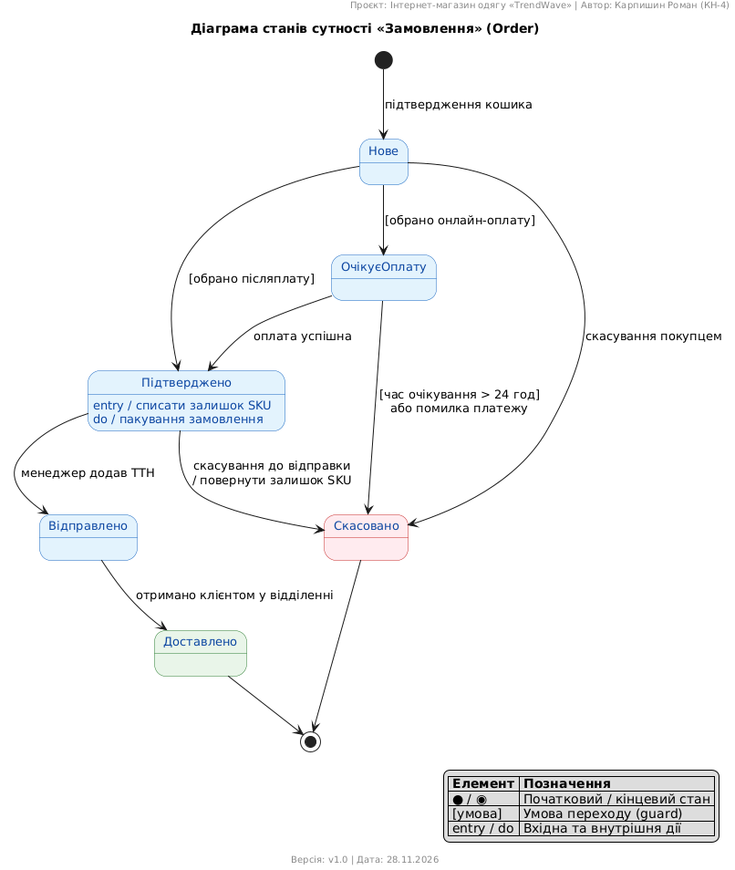
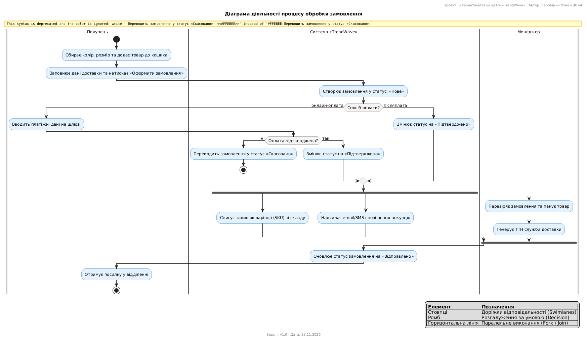

# Побудова моделі програмної системи засобами UML

## 1. Єдиний шаблон оформлення діаграм проєкту «TrendWave»

Для всіх UML-діаграм проєкту затверджено єдиний стандарт оформлення:
* **Метадані (шапка та футер):** назва діаграми, назва проєкту («TrendWave»), автор (Карпишин Роман, група КН-4), версія (`v1.0`) та дата створення.
* **Кольорова палітра:**
  * основні елементи / активні стани — світло-блакитний (`#E3F2FD`, рамка `#1565C0`);
  * зовнішні системи / допоміжні блоки — світло-сірий (`#F5F5F5`, рамка `#616161`);
  * кінцеві або помилкові стани — світло-червоний (`#FFEBEE`, рамка `#C62828`).
* **Шрифти:** беззасічковий шрифт `Arial` / `SansSerif`, розмір `12–14 pt`.
* **Легенда нотації:** розміщується у правому нижньому куті кожної діаграми з поясненням використаних стрілок та символів.

---

## 2. Тренувальне завдання (Нейтральний приклад «Інтернет-магазин»)

1. **Діаграма варіантів використання** (`docs/diagrams/train-uc.puml` / `.png`) — 2 актори (*Покупець*, *Адміністратор*) та 3 прецеденти (*Перегляд товарів*, *Оформлення замовлення*, *Керування товарами*).
2. **Діаграма класів** (`docs/diagrams/train-class.puml` / `.png`) — 3 класи (`Customer`, `Order`, `Product`) з атрибутами, методами та зв'язками з кратністю (`1` до `0..*`, `1..*` до `1..*`).
3. **Діаграма послідовності** (`docs/diagrams/train-seq.puml` / `.png`) — 3 учасники (*Покупець*, *Кошик*, *Сервіс замовлень*) та 4 послідовні повідомлення.
4. **Діаграма станів замовлення** (`docs/diagrams/train-state.puml` / `.png`) — 5 базових станів (*Нове*, *Оплачене*, *Відправлене*, *Доставлене*, *Скасоване*).

---

## 3. Діаграма станів сутності «Замовлення» (`Order`) проєкту «TrendWave»

*Вихідний код: [`docs/diagrams/state-order.puml`](diagrams/state-order.puml)*

**Опис життєвого циклу:** Замовлення створюється у стані `Нове` після підтвердження кошика. Залежно від обраного способу оплати воно переходить у стан `Очікує оплату` (онлайн-еквайринг) або одразу в `Підтверджено` (післяплата). Після пакування та генерації ТТН замовлення переходить у `Відправлено`, а після отримання клієнтом — у фінальний стан `Доставлено`. На етапах до відправки замовлення може перейти у фінальний стан `Скасовано` (за ініціативою клієнта або при несплаті протягом 24 годин).

---

## 4. Діаграма діяльності складного процесу обробки замовлення (Swimlanes + Fork/Join)

*Вихідний код: [`docs/diagrams/act-order-complex.puml`](diagrams/act-order-complex.puml)*

**Опис процесу:** Діаграма поділена на 3 доріжки відповідальності (*Покупець*, *Система «TrendWave»*, *Менеджер*). Після оформлення замовлення покупцем система використовує розгалуження для перевірки типу оплати, а після підтвердження застосовує паралельний блок (`fork` / `join`): одночасно виконуються списання залишків зі складу, надсилання сповіщення покупцю та передача замовлення менеджеру на пакування.

---

## 5. Перевірка діаграм за чек-листом нотації UML

| Критерій перевірки | Статус | Результат перевірки та виправлення |
| :--- | :---: | :--- |
| **Імена елементів** | Виконано | Усі класи названо іменниками в однині (`Order`, `Product`), прецеденти — дієсловами, стани — прикметниками/дієприкметниками (`Нове`, `Відправлено`). |
| **Напрямок стрілок** | Виконано | Стрілки переходів, повідомлень та залежностей відповідають реальному потоку керування та даних. |
| **Кратність зв'язків** | Виконано | На діаграмі класів вказано точну кратність (`1`, `0..*`, `1..*`) на обох кінцях кожної асоціації. |
| **Стереотипи та умови** | Виконано | Використано умови переходу у квадратних дужках (`[оплата успішна]`, `[час > 24 год]`), початкові та кінцеві вузли. |
| **Відсутність зайвих зв'язків** | Виконано | Видалено дублюючі лінії переходів, перетини зведено до мінімуму, додано єдину легенду. |

---

## 6. Відповіді на контрольні запитання

**1. Для чого призначені діаграми станів і діяльності?**
* **Діаграма станів (State Machine Diagram)** описує життєвий цикл одного конкретного об’єкта (наприклад, замовлення): у яких станах він може перебувати та які події чи умови викликають перехід із одного стану в інший.
* **Діаграма діяльності (Activity Diagram)** моделює потік керування або бізнес-процес у цілому (послідовність дій, розгалуження за умовами, паралельні процеси та розподіл обов’язків між ролями).

**2. Які символи видимості застосовують у класах?**
У UML для атрибутів і методів класу використовують чотири символи видимості:
* `+` (**public**) — відкритий доступ (елемент доступний з будь-якого іншого класу);
* `-` (**private**) — закритий доступ (доступний лише всередині самого класу);
* `#` (**protected**) — захищений доступ (доступний всередині класу та його спадкоємців);
* `~` (**package**) — пакетний доступ (доступний усім класам у межах одного пакета/модуля).

**3. Що таке кратність зв’язку? Наведіть приклади.**
* **Кратність (Multiplicity)** — це вказівка на те, скільки екземплярів одного класу може бути пов’язано з одним екземпляром іншого класу.
* *Приклади:* `1` (рівно один), `0..1` (нуль або один), `0..*` або `*` (нуль або багато), `1..*` (один або багато). Наприклад, один клієнт (`1`) може створити багато замовлень (`0..*`).

**4. Як вибрати діаграму для конкретної задачі?**
Вибір залежить від того, на яке запитання потрібно відповісти:
* *Хто і що робить у системі?* → **Use Case** (варіантів використання).
* *Які сутності існують і як вони пов'язані?* → **Class Diagram** (класів).
* *Як об'єкти обмінюються викликами в часі?* → **Sequence Diagram** (послідовності).
* *Як змінюються стани одного об'єкта?* → **State Machine Diagram** (станів).
* *Як крок за кроком виконується бізнес-процес із паралельними діями?* → **Activity Diagram** (діяльності).
