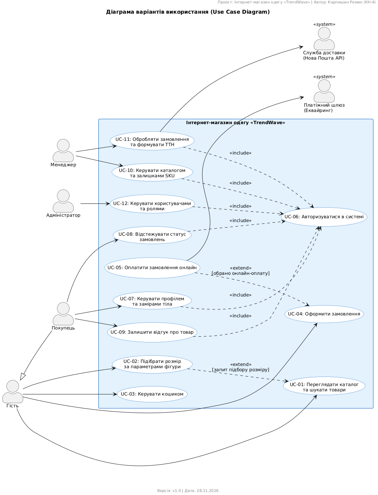

# Діаграма варіантів використання та опис сценаріїв («TrendWave»)

## 1. Діаграма варіантів використання (Use Case Diagram)

*Вихідний код: [`docs/diagrams/uc-main.puml`](diagrams/uc-main.puml)*

### Задіяні актори та зв'язки:
* **Первинні актори:** Гість, Покупець (успадковує всі можливості Гостя через відношення узагальнення), Менеджер, Адміністратор.
* **Вторинні актори (зовнішні системи):** Платіжний шлюз (еквайринг онлайн-оплат), Служба доставки (API Нової Пошти).
* **Відношення `«include»`:** усі персональні та адміністративні прецеденти (`UC-07` — `UC-12`) обов'язково включають базовий прецедент `UC-06: Авторизуватися в системі`.
* **Відношення `«extend»`:** `UC-02: Підібрати розмір` розширює перегляд товару за запитом користувача, а `UC-05: Оплатити замовлення онлайн` розширює оформлення замовлення за умови вибору безготівкового розрахунку.

---

## 2. Опис трьох ключових варіантів використання (Таблиця 9.1)

### 2.1. UC-02: Підібрати розмір за параметрами фігури

| Поле | Опис |
| :--- | :--- |
| **Назва / ID** | `UC-02`: Підібрати розмір за параметрами фігури |
| **Актор** | Гість, Покупець |
| **Передумови** | Користувач відкрив картку товару, для якого менеджером заповнено таблицю лекал та вказано тип крою. |
| **Основний сценарій** | 1. Користувач натискає кнопку «Підібрати мій розмір» на сторінці товару. 2. Система перевіряє наявність збережених замірів у профілі (якщо користувач авторизований — підставляє їх автоматично). 3. Користувач вводить або підтверджує свій зріст, обхват грудей, талії та стегон (у см) і натискає «Розрахувати». 4. Система порівнює введені параметри з таблицею лекал моделі з урахуванням припусків на крій (*Slim*, *Regular*, *Oversize*). 5. Система підсвічує рекомендований розмір (наприклад, «L») і виводить підказку щодо посадки. |
| **Альтернативні сценарії** | **3а.** Користувач ввів нереалістичні числові значення (наприклад, зріст `50 см` або від'ємне число) → система підсвічує поле червоним і виводить повідомлення про допустимий діапазон замірів. **4а.** Параметри користувача знаходяться на межі двох сусідніх розмірів (M і L) → система пропонує обидва варіанти з поясненням («M — для щільної посадки, L — для вільнішої»). |
| **Післяумови** | На сторінці товару активовано рекомендований розмір (якщо він є в наявності на складі). |
| **Пов’язані вимоги** | `FR-04`, `FR-05`, `FR-06`, `NFR-01` |

---

### 2.2. UC-04: Оформити замовлення

| Поле | Опис |
| :--- | :--- |
| **Назва / ID** | `UC-04`: Оформити замовлення |
| **Актор** | Гість, Покупець (вторинний актор: Платіжний шлюз) |
| **Передумови** | У кошику користувача є хоча б одна варіація товару (SKU), доступний залишок якої на складі `≥ 1`. |
| **Основний сценарій** | 1. Користувач переходить у кошик і натискає «Оформити замовлення». 2. Система відображає форму замовлення та заповнює відомі контактні дані (для авторизованого Покупця). 3. Користувач вводить ПІБ, номер телефону, email, обирає службу доставки («Нова Пошта» / «Укрпошта»), місто, відділення та спосіб оплати. 4. Користувач натискає «Підтвердити замовлення». 5. Система перевіряє актуальність залишків SKU, створює запис замовлення у статусі «Нове», списує кількість товарів зі складу та очищає кошик. 6. Система відображає сторінку підтвердження з номером замовлення та надсилає лист на email. |
| **Альтернативні сценарії** | **3а.** Обрано спосіб оплати «Онлайн карткою» → після кроку 5 активується розширення `UC-05: Оплатити замовлення онлайн` (перенаправлення на Платіжний шлюз). **5а.** Поки користувач заповнював форму, останню одиницю товару викупив інший клієнт → система скасовує створення замовлення й повідомляє, яка позиція закінчилася. |
| **Післяумови** | У БД зафіксовано нове замовлення, складські залишки відповідних SKU зменшено, кошик очищено. |
| **Пов’язані вимоги** | `FR-08`, `FR-09`, `FR-13`, `NFR-04`, `NFR-05` |

---

### 2.3. UC-10: Керувати каталогом та залишками SKU

| Поле | Опис |
| :--- | :--- |
| **Назва / ID** | `UC-10`: Керувати каталогом та залишками SKU |
| **Актор** | Менеджер |
| **Передумови** | Користувач авторизований у системі (`UC-06`) та має роль «Менеджер» або «Адміністратор». |
| **Основний сценарій** | 1. Менеджер відкриває розділ «Товари та склад» в адміністративній панелі. 2. Натискає «Додати новий товар» (або обирає існуючий для редагування). 3. Заповнює назву, категорію, сезон, ціну, склад тканини, тип крою, таблицю лекал та завантажує фотографії. 4. Додає варіації товару (комбінації «Колір + Розмір») і вказує точну кількість одиниць на складі для кожної варіації. 5. Натискає «Зберегти та опублікувати». 6. Система валідує дані, оптимізує зображення та оновлює публічний каталог. |
| **Альтернативні сценарії** | **4а.** Менеджер встановлює залишок `0` для конкретного розміру → система зберігає варіацію, але автоматично блокує її вибір для покупців у каталозі. **5а.** Не заповнено обов’язкові поля (ціна або таблиця лекал) → система не публікує товар і підсвічує незаповнені поля. |
| **Післяумови** | Новий або оновлений товар із актуальними залишками SKU збережено в БД і відображається в каталозі. |
| **Пов’язані вимоги** | `FR-12`, `FR-13`, `NFR-01` |

---

## 3. Індивідуальне завдання: Розширені альтернативні сценарії (UC-11)

### Варіант використання `UC-11`: Обробляти замовлення та формувати ТТН

* **Актор:** Менеджер (вторинний актор: Служба доставки «Нова Пошта API»).
* **Передумови:** Менеджер авторизований у системі; у черзі є замовлення зі статусом «Підтверджено».
* **Основний сценарій:**
  1. Менеджер відкриває картку підтвердженого замовлення в адмін-панелі та перевіряє комплектацію посилки.
  2. Натискає кнопку «Сформувати ТТН та відправити».
  3. Система формує запит до API служби доставки з даними отримувача, вагою та габаритами посилки.
  4. Служба доставки повертає 14-значний номер ТТН.
  5. Система зберігає ТТН у замовленні, змінює статус на «Відправлено» та надсилає трек-номер покупцю.

* **Розширені альтернативні сценарії (обробка винятків):**
  1. **Виняток 1 — Недійсні дані (`2а. Некоректні дані отримувача або неіснуюче відділення`):**
     * *Причина:* покупець при оформленні вказав неправильний формат телефону або обрав відділення, яке тимчасово зачинене / має обмеження за вагою.
     * *Реакція системи:* API служби доставки повертає помилку валідації; система перехоплює її, відображає менеджеру зрозуміле повідомлення із зазначенням проблемного поля (наприклад, *«Відділення №5 тимчасово не приймає посилки»*) та відкриває форму швидкого редагування адреси доставки без втрати введених даних.
  2. **Виняток 2 — Відсутність доступу (`1а. Спроба доступу без прав або із завершеною сесією`):**
     * *Причина:* термін дії JWT-токена менеджера сплив під час роботи або запит до ендпоінту зміни статусу виконує користувач із роллю «Покупець».
     * *Реакція системи:* сервер відхиляє запит із кодом `HTTP 401 Unauthorized` (при простроченій сесії — перенаправляє на сторінку входу зі збереженням URL) або `HTTP 403 Forbidden` (при недостатніх правах — блокує операцію, виводить повідомлення *«Доступ заборонено»* та фіксує спробу в журналі безпеки).
  3. **Виняток 3 — Технічна помилка (`3а. Тайм-аут або недоступність зовнішнього API служби доставки`):**
     * *Причина:* сервер Нової Пошти не відповідає понад 5 секунд або повертає помилку `HTTP 503 Service Unavailable`.
     * *Реакція системи:* система не змінює статус замовлення на «Відправлено» (зберігає цілісність даних), виводить менеджеру попередження *«Сервіс доставки тимчасово недоступний. Повторіть спробу пізніше або введіть номер ТТН вручну»*, розблоковує поле для ручного введення вже створеної накладної та логує помилку інтеграції для адміністратора.

---

## 4. Чек-лист перевірки діаграми Use Case

| Критерій перевірки | Статус | Коментар |
| :--- | :---: | :--- |
| **Актор — це роль, а не конкретна особа** | Виконано | Використано узагальнені ролі (*Гість*, *Покупець*, *Менеджер*, *Адміністратор*), а не власні імена. |
| **Наявність межі системи** | Виконано | Усі 12 прецедентів розміщено всередині прямокутника системи «Інтернет-магазин одягу "TrendWave"», а актори — ззовні. |
| **Правильна деталізація прецедентів** | Виконано | Кожен прецедент описує закінчену дію з цінністю для актора (назви сформульовано у дієслівній формі). |
| **Доречність `«include»` та `«extend»`** | Виконано | `«include»` використано для обов'язкової авторизації (`UC-06`), а `«extend»` — для опціональних гілок (`UC-02`, `UC-05`) із зазначенням умов. |
| **Наявність детальних сценаріїв** | Виконано | Описано 3 ключові прецеденти за шаблоном та розширений сценарій із 3 винятками для `UC-11`. |

---

## 5. Відповіді на контрольні запитання

**1. Що таке актор? Чим він відрізняється від користувача?**
* **Актор (Actor)** — це зовнішня сутність (роль людини, інша програмна система або апаратний пристрій), яка взаємодіє із системою для досягнення певної мети.
* **Відмінність від користувача:** користувач — це конкретна фізична особа, тоді як актор — це **роль**. Одна й та сама людина може виступати в різних ролях (наприклад, спочатку як *Гість*, а після входу — як *Покупець*), і навпаки: одну роль *Покупця* виконують тисячі реальних користувачів. Крім того, актором може бути зовнішня система (наприклад, Платіжний шлюз), а не людина.

**2. Чим `include` відрізняється від `extend`?**
* **`«include»` (включення)** означає **обов’язкове** використання базового прецеденту: основний сценарій не може завершитися без виконання включеного (наприклад, перегляд замовлень обов’язково включає авторизацію). Стрілка спрямована *від основного прецеденту до включеного*.
* **`«extend»` (розширення)** означає **необов’язкову (додаткову)** поведінку, яка спрацьовує лише за певної умови (наприклад, онлайн-оплата розширює оформлення замовлення тільки тоді, коли клієнт обрав оплату карткою). Стрілка спрямована *від розширення до основного прецеденту*.

**3. З яких частин складається опис варіанта використання?**
Класичний текстовий опис (специфікація прецеденту) містить:
1. Унікальний ідентифікатор та назву (`UC-ID`).
2. Основного та вторинних акторів.
3. Передумови (*Preconditions*) — стан системи до початку сценарію.
4. Основний потік подій (*Main Flow*) — покроковий «успішний» сценарій.
5. Альтернативні потоки та винятки (*Alternative / Exception Flows*) — відгалуження та обробка помилок.
6. Післяумови (*Postconditions*) — стан системи після завершення.
7. Посилання на пов’язані вимоги (`FR`, `NFR`).

**4. Які типові помилки трапляються в Use Case-діаграмах?**
* Використання імен конкретних людей або посад замість ролей;
* Надмірна деталізація — перетворення прецедентів на окремі кнопки чи поля форми (наприклад, «Ввести логін» замість «Авторизуватися»);
* Плутанина у напрямку стрілок `«include»` та `«extend»`;
* Побудова блок-схеми замість Use Case (спроба показати порядок виконання кроків стрілками між усіма овалами);
* Відсутність межі системи або розміщення зовнішніх систем всередині прямокутника системи.
